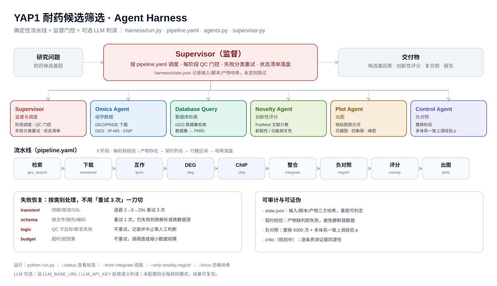

# AI4OmicsAnalysis

**确定性流水线 + 监督门控 + 可选 LLM 判读** 的组学筛选 agent harness。
把"多数据集耐药候选基因"这类筛选做成可审计、可断点续跑、可写进论文方法学的工程，
而不是一段跑完就散的手工脚本链。



## 它解决什么

| 痛点 | 机制 |
|---|---|
| 脚本改了，结果没跟着更新 | 每阶段**三方哈希**（脚本/输入/产物）落盘 `state.json`，重跑自动判定 |
| 失败一律重试 3 次，逻辑错误被放大 | 失败分四类（transient/schema/logic/budget），各配恢复策略 |
| 产物列改名，下游静默出错 | pipeline.yaml 声明**产物契约**（必需列），缺列即失败 |
| 筛出的 7 个基因，审稿人问"随机能得几个" | 内置**负对照**：置换检验 + 模式经验 p 值 |
| 本机跑组学又慢又吃内存 | `execution: ssh` 一键切服务器执行，产物自动拉回 |
| LLM 幻觉混进数据 | LLM 只在语义层（新颖性/归因/critic），不配置则全程规则模式 |

## 快速开始

```bash
pip install pyyaml pandas numpy matplotlib   # 或 pip install -e .

python -m ai4omics doctor --pipeline pipeline.yaml   # 环境/SSH 自检
python -m ai4omics run --pipeline pipeline.yaml      # 全流程（哈希未变阶段自动跳过）
python -m ai4omics status --pipeline pipeline.yaml   # 看每阶段状态/行数/错误
```

一个阶段的最小定义：

```yaml
base: /data/omics/myproject          # 项目根
python: /opt/mambaforge/envs/omics/bin/python
stages:
  - id: deg
    agent: omics                      # omics | dbquery | novelty | plotting
    tools: ["scripts/02_deg.R"]       # 相对 base 的脚本
    expect: [results/deg_all.csv]
    contract: {results/deg_all.csv: {columns: [gene, log2FC, padj]}}
    qc: {min_rows: {results/deg_all.csv: 500}}
```

## 服务器执行（组学任务建议）

DEG/Seurat/大矩阵 IO 在笔记本上慢且吃内存，生产建议 64GB+ 内存的服务器：

```yaml
execution: ssh
remote: {host: sxycloud-x2, workdir: /data/omics/myproject}
```

详见 **[docs/server-setup.md](docs/server-setup.md)**（SSH 免密、mamba 环境、硬件选型、rsync 同步）。

## 完整示例

[examples/yap1_breast/](examples/yap1_breast/) —— YAP1 乳腺癌耐药候选筛选：
20 个 GEO 表达数据集 + 6 个 PRIDE IP-MS + YAP/TEAD4 ChIP-seq 三重筛选，
9 阶段流水线（检索→下载→互作→DEG→ChIP→整合→负对照→新颖性评分→出图），
含复现用的[负对照脚本](examples/yap1_breast/negative_control.py)与
[复合图绘制提示词](examples/yap1_breast/docs/绘图提示词.md)。

## 文档

- [架构图绘制提示词](docs/architecture-prompt.md) —— 任何 agent 可复现 README 图
- [服务器配置指南](docs/server-setup.md)
- [设计原则与已知边界](docs/design-principles.md) —— 诚实清单：什么已实现、什么没有

## Roadmap

- [ ] critic 阶段：逐条质询候选的证据同源性（IP 丰度假象、ChIP blacklist、hg19/38 混用）
- [ ] retrospective 基准：隐藏已知 YAP1 伙伴，检验流水线能否自己捞回
- [ ] DEG 阈值校准内置为通用工具（padj × log2FC 网格搜索目标区间）
- [ ] LLM critic：候选两两锦标赛排序 + rank 稳定性报告

## License

MIT
